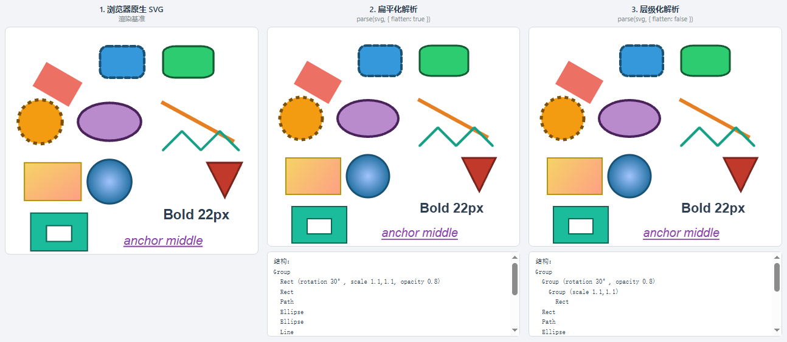

# leafer-x-svg

> 一个轻量的支持[LeaferJS](https://www.leaferjs.com/)对象和svg相互转换的库

`leafer-x-svg` 将 SVG 字符串`parse`解析为 LeaferUI 的可视化对象（`Group` / `Path` / `Rect` / `Ellipse` / `Line` / `Polygon` / `Text` / `Image`），解析结果可直接添加到 Leafer 画布中渲染，适合图标导入、素材编辑器、白板等场景。

同时也提供反向能力 `formate`：把 Leafer 对象序列化回 SVG 字符串，可与 `parse` 组成「SVG ⇄ Leafer」双向转换。无 SVG 对应语义的能力会**降级处理**（几何近似为 `path` 等），降级不了的直接**舍弃**，并把每次降级 / 舍弃记录到结果中（详见 [Leafer → SVG（formate）](#leafer--svgformate)）。



## 特性

- **双向转换**：`parse`（SVG → Leafer）与 `formate`（Leafer → SVG），可往返互转
- **支持的 SVG 元素**：`path`、`rect`、`circle`、`ellipse`、`line`、`polyline`、`polygon`、`text`、`image`
- **双层级模式**：扁平化（全部叶子摊平到单层 Group，样式 / 变换 / 透明度烘焙到叶子）与层级模式（保留 `<g>` 嵌套结构，映射为嵌套 Group），通过 `options.flatten` 切换
- **viewBox 处理**：解析 `viewBox` / `width` / `height` / `preserveAspectRatio`（含根 `<svg>` 元素），并转换为等价变换
- **`<use>` 引用展开**：将 `<use xlink:href>` 内联为实际元素
- **CSS 规则**：解析 `<style>` 中的标签 / class / id 选择器规则
- **样式继承**：解析 `style` 属性，并沿父级 `<g>` 递归继承属性（扁平化模式下烘焙进叶子，层级模式下由 Leafer 父子层级承担）
- **transform 完整分解**：`matrix` / `translate` / `scale` / `rotate` / `skew` 通过 Leafer `setTransform` 整体分解为 `x` / `y` / `scaleX` / `scaleY` / `rotation` / `skewX` / `skewY`，**保留旋转与倾斜**
- **渐变填充**：`linearGradient` / `radialGradient`（含 `stop`、`gradientUnits`、`xlink:href` 继承、`gradientTransform` 平移分量）映射为 Leafer Paint 对象
- **透明度合并**：`fill-opacity` / `stroke-opacity` 自动合并进颜色值（纯色）或 Paint 的 `opacity` 字段（渐变）
- **描边样式完整映射**：`stroke-dasharray` / `stroke-dashoffset` / `stroke-linecap` / `stroke-linejoin` / `stroke-miterlimit` / `vector-effect` / `fill-rule`，描边默认居中对齐（忠实 SVG 语义）
- **颜色解析**：支持 hex / rgb(a) / hsl(a) / 颜色关键字
- **文本**：`font-family` / `font-size` / `font-style` / `font-weight` / `font`（简写）/ `letter-spacing` / `text-decoration` / `text-anchor`（映射为 Leafer `textAlign`），并做基线对齐修正
- **元素追踪**：每个解析出的元素带唯一 `id`，并可通过 `data-c` 属性保留原始元素标识（`data.originalId`）

## 安装

```bash
npm install leafer-x-svg
```

要求 `leafer-ui >= 1.0.0`（peer dependency，需自行安装）：

```bash
npm install leafer-ui
```

## 使用

### ESM

```ts
import { parse, formate } from 'leafer-x-svg';
import { Leafer } from 'leafer-ui';

const svg = `<svg xmlns="http://www.w3.org/2000/svg" viewBox="0 0 100 100">
  <rect x="10" y="10" width="30" height="30" fill="blue"/>
  <circle cx="70" cy="20" r="10" fill="green" fill-opacity="0.5"/>
  <path d="M10 80 L50 80 L30 50 Z" fill="red"/>
</svg>`;

// 扁平化解析（默认）
const group = parse(svg);

// 层级化解析（保留 <g> 嵌套，映射为嵌套 Group）
const nested = parse(svg, { flatten: false });

// 覆盖填充色 / 设置类名
const icon = parse(svg, { 
  // 是否扁平化解析结果
  flatten: true,
 });

// 直接添加到 Leafer 画布
const leafer = new Leafer({ view: window });
leafer.add(group);

// 反向：Leafer 对象 → SVG 字符串
const { svg: svgString, degrades } = formate(group, {
  precision: 3,        // 小数位数，默认 4
  pretty: true,        // 缩进换行，默认 true
  includeReport: true, // 把降级记录写入 SVG 注释，默认 true
});

console.log(svgString);
```

### UMD / CDN

```html
<script src="https://unpkg.com/leafer-ui"></script>
<script src="https://unpkg.com/leafer-x-svg"></script>
<script>
  const group = LeaferXSvg.parse('<svg>...</svg>');
  const { svg, degrades } = LeaferXSvg.formate(group);
</script>
```

## API

### `parse(svgString, options?)` → `Group | undefined`

| 参数 | 类型 | 说明 |
| --- | --- | --- |
| `svgString` | `string` | SVG 字符串（`<svg>` 根元素） |
| `options` | [`ParseOptions`](#parseoptions)? | 解析选项 |

返回一个包含全部解析元素的 `Group`；SVG 中无有效元素时返回 `undefined`。

#### `ParseOptions`

```ts
interface ParseOptions {
  /**
   * 是否扁平化解析结果，默认 true。
   * true  : 全部叶子摊平到单层 Group，父级样式 / 变换 / 透明度烘焙到叶子
   * false : 保留 <g> 嵌套层级（映射为嵌套 Group），
   *         变换 / 透明度 / 可见性由 Leafer 父子层级天然继承
   */
  flatten?: boolean;
  /** 设置到返回的 Group 及所有子元素上的类名 */
  className?: string;
  /** 提供时覆盖所有子元素的填充色 */
  fill?: string;
}
```

**两种模式的差异**：

| 维度 | `flatten: true`（默认） | `flatten: false` |
| --- | --- | --- |
| 输出结构 | 单层 `Group`，所有叶子直接挂载 | 保留 `<g>` 嵌套，映射为嵌套 `Group` |
| 变换 | 父级变换累乘后 `setTransform` 烘焙到叶子 | 元素自身变换设置在自身上，父级由嵌套 Group 承担 |
| 透明度 | 父级 `opacity` 连乘到叶子 | 各层 `opacity` 设置在对应 Group 上（**与 SVG 语义完全一致**，子元素重叠时按组合并渲染） |
| 可见性 | `display:none` / `visibility:hidden` 沿父级向下强制子级隐藏 | 设置在对应 Group 上，由 Leafer 层级天然隐藏子树 |
| 适用场景 | 图标导入、单图元编辑、JSON 序列化体积敏感 | 保留分组结构、需要分组整体操作（整体透明度 / 整体隐藏 / 分组拖拽） |

> 扁平化模式下，分组透明度采用"父级 opacity 连乘到叶子"的近似：子元素互相重叠时的合并效果与浏览器 SVG 的"整组合成"略有差异（重叠处会更透）。若对分组透明度语义要求严格，请使用 `flatten: false`。

#### 解析行为说明

- 每个子元素带有唯一 `id`（uuid），`data.originalId` 取自元素的 `data-c` 属性，无该属性时自动生成（`other-` 前缀 + uuid）
- `<text>` 的 `(x, y)` 是字母基线起点，内部已做基线对齐修正（Leafer `Text` 的 `(x, y)` 是文本框顶边）
- 子元素的 `hitRadius` 默认为 5（拾取容差），`Group` 设置 `hitFill: 'pixel'`
- 描边默认 `strokeAlign: 'center'`（SVG 语义：沿路径居中展开；Leafer 对闭合图形默认内描边，需显式对齐）
- `<polygon>` 的 `closed` 强制为 `true`（SVG `<polygon>` 始终闭合）

### `createEmptyResponse()` → `SVGParsingOutput`

返回一个空的解析结果对象（`{ objects: [], elements: [], options: {}, allElements: [] }`）。

### `formate(input, options?)` → `FormateResult`

把 Leafer 对象序列化为 SVG 字符串（`parse` 的反向操作）。

| 参数 | 类型 | 说明 |
| --- | --- | --- |
| `input` | `UI \| UI[]` | 单个 Leafer 元素，或元素数组，或带 `children` 的 `Group` |
| `options` | [`FormatOptions`](#formatoptions)? | 序列化选项 |

返回 `{ svg, degrades }`：

- `svg`：生成的 SVG 字符串（含 `<defs>` 渐变定义与根 `<svg>` 的 `viewBox` / `width` / `height`）
- `degrades`：降级 / 舍弃记录数组 `IFormatDegrade[]`，每项为 `{ at, tag?, id?, action, detail }`，`action` 为 `'degrade'`（降级）或 `'skip'`（舍弃）

#### `FormatOptions`

```ts
interface FormatOptions {
  /** 根 <svg> 的 width / height；不提供时自动取内容包围盒（含描边） */
  width?: number;
  height?: number;
  /** 根 <svg> 的 viewBox [minX, minY, width, height]；不提供时按内容包围盒推导 */
  viewBox?: [number, number, number, number];
  /** 根 <svg> 的 preserveAspectRatio，默认 `xMidYMid meet` */
  preserveAspectRatio?: string;
  /** 小数保留位数，默认 4 */
  precision?: number;
  /** 是否格式化输出（缩进换行），默认 true */
  pretty?: boolean;
  /** 是否把降级 / 舍弃记录写入 SVG 注释，默认 true */
  includeReport?: boolean;
  /** 收集每条降级 / 舍弃记录（includeReport 为 false 时也可用它获取记录） */
  onDegrade?: (item: IFormatDegrade) => void;
  /** 未知 / 自定义类型元素的外部处理回调，见下方说明 */
  onUnknownElement?: (ctx: IUnknownElementContext) => IFormatElement | undefined | null;
}
```

#### 未知 / 自定义类型元素（`onUnknownElement`）

Leafer 的 `__tag` 若无法识别（如用户自定义类型），会调用 `onUnknownElement` 回调交由外部处理：

| 情况 | 处理 |
| --- | --- |
| 返回 `IFormatElement`（`tag` 非空） | 采用为该元素的 SVG 输出，子元素递归后挂到返回元素下 |
| 回调为空（未提供） | 舍弃该元素 |
| 返回空（`undefined` / `null` / `tag` 为空） | 舍弃该元素 |
| 回调抛出异常 | 舍弃该元素（记录 skip） |
| 以上「舍弃」情形，`children` 不为空 | 子元素仍走正常递归流程，提升到父级输出 |

回调上下文 `IUnknownElementContext`：

| 字段 | 说明 |
| --- | --- |
| `ui` | 元素的 Leafer 对象（只读参考，可读取自定义属性） |
| `tag` | 无法识别的 `__tag` 类型名 |
| `id` | 元素 `id`（若有） |
| `hasChildren` | 是否有未处理的子元素 |
| `note(action, detail)` | 记录降级 / 舍弃信息到 `degrades`（可选，供外部补充说明） |
| `helper` | 内置图元构建器集合（见下），外部可复用生成 `IFormatElement` |

`helper`（`IFormatHelper`）挂载了与 formate 内部一致的图元构建器，回调中可直接调用：

| 方法 | 生成的 SVG 元素 |
| --- | --- |
| `helper.buildRect(ui)` | `<rect>`（各角圆角不一致时降级为 `<path>`） |
| `helper.buildEllipse(ui)` | `<ellipse>`（扇环 / 圆弧降级为 `<path>`） |
| `helper.buildLine(ui)` | `<polyline>` / `<polygon>` / 降级 `<path>` |
| `helper.buildPolygon(ui)` | `<polygon>` / `<polyline>` / 降级 `<path>` |
| `helper.buildPath(ui)` | `<path>` |
| `helper.buildText(ui)` | `<text>` / 多行 `<tspan>` |
| `helper.buildImage(ui)` | `<image>` |
| `helper.buildGroup(ui)` | `<g>`（子元素由 formate 递归后自动挂载） |
| `helper.buildFallbackPath(ui, label?)` | 未知图元降级为 `<path>`（`getPath(true)`） |

示例：

```ts
const { svg, degrades } = formate(group, {
  onUnknownElement: ({ tag, ui, helper, note }) => {
    // 按自定义类型分发到内置构建器
    if (tag === 'MyRect') return helper.buildRect(ui);
    if (tag === 'MyCircle') return helper.buildEllipse(ui);
    if (tag === 'MyWidget') {
      note('degrade', 'MyWidget 已降级为矩形');
      return { tag: 'rect', attrs: { width: '10', height: '10', fill: 'red' }, children: [] };
    }
    return undefined; // 其余未知类型舍弃（children 仍会递归输出）
  },
});
```

## SVG → Leafer 属性映射

| SVG 属性 / 元素 | Leafer 属性 | 说明 |
| --- | --- | --- |
| `fill` / `fill-opacity` | `fill` | 纯色：透明度合并进 rgba；`fill="none"` → `fill: null` |
| `fill-rule` | `windingRule: 'nonzero' \| 'evenodd'` | |
| `stroke` / `stroke-opacity` | `stroke` | 同 fill 的透明度处理 |
| `stroke-width` | `strokeWidth` | |
| `stroke-dasharray` | `dashPattern: number[]` | 奇数个值时按 SVG 规则复制一遍 |
| `stroke-dashoffset` | `dashOffset` | |
| `stroke-linecap` | `strokeCap: 'none' \| 'round' \| 'square'` | `butt` → `none` |
| `stroke-linejoin` | `strokeJoin: 'miter' \| 'bevel' \| 'round'` | |
| `stroke-miterlimit` | `miterLimit` | |
| `vector-effect="non-scaling-stroke"` | `strokeScaleFixed: true` | |
| （描边对齐） | `strokeAlign: 'center'` | 与 SVG 描边语义一致 |
| `opacity` | `opacity` | 扁平化模式下父级连乘；层级模式下设置在对应 Group |
| `display` / `visibility` | `visible` | |
| `transform` | `x` / `y` / `scaleX` / `scaleY` / `rotation` / `skewX` / `skewY` | 通过 `setTransform` 整体分解 |
| `font-family` | `fontFamily` | 仅 `<text>` |
| `font-size` | `fontSize` | 仅 `<text>` |
| `font-weight` | `fontWeight` | 数字或关键字（`bold`→700 等） |
| `font-style="italic"` | `italic: true` | |
| `font`（简写） | `fontFamily` / `fontSize` / `fontWeight` / `italic` | 由 `parseFontDeclaration` 拆解 |
| `letter-spacing` | `letterSpacing`（px） | fabric 的 1/1000 em 单位已换算 |
| `text-decoration` | `textDecoration: 'under' \| 'delete' \| 'under-delete'` | 见"不支持"清单 |
| `text-anchor` | `textAlign: 'left' \| 'center' \| 'right'` | `start`→`left`、`middle`→`center`、`end`→`right` |
| `<path d="...">` | `Path({ path })` | |
| `<rect>` | `Rect({ width, height, cornerRadius })` | `rx === ry` 时；`rx !== ry` 降级为 `Path`（见下） |
| `<circle>` / `<ellipse>` | `Ellipse({ width, height })` | `circle` 用 `r`；`ellipse` 用 `rx` / `ry` |
| `<line x1 y1 x2 y2>` | `Line({ points: [x1, y1, x2, y2] })` | |
| `<polyline points>` | `Line({ points, closed: false })` | |
| `<polygon points>` | `Polygon({ points, closed: true })` | |
| `<text>` | `Text({ text, ... })` | |
| `<image xlink:href>` | `Image({ url, width, height })` | |
| `linearGradient` / `radialGradient` | `fill: Paint`（`type: 'linear' \| 'radial'`） | 见"渐变支持" |
| `viewBox` / `width` / `height` / `preserveAspectRatio` | 等价变换矩阵 | 含根 `<svg>` 元素 |

### 渐变支持

支持：

- `gradientUnits="objectBoundingBox"`（默认，百分比 / 比例坐标）
- `gradientUnits="userSpaceOnUse"`（用户空间单位坐标）
- `stop-color` / `stop-opacity` / `style`
- `linearGradient` 的 `x1` / `y1` / `x2` / `y2`（含百分比与纯数字比例形式）
- `radialGradient` 的 `cx` / `cy` / `r`（含 `fr` 作为半径下限）
- `xlink:href` 属性 / stop 继承（另一渐变的属性与 stop）
- `gradientTransform` 的**平移分量**（换算进坐标）

降级处理（不支持精确语义）：

- `gradientTransform` 的旋转 / 缩放 / 倾斜分量（仅取平移部分）
- `radialGradient` 的焦点 `fx` / `fy` 精确语义（focal point，近似为渐变中心）
- `userSpaceOnUse` 下的百分比坐标（近似按元素包围盒换算）

无法解析的渐变引用（如循环引用、无有效 stop）按无填充处理。

### `rx !== ry` 的圆角矩形

SVG `<rect>` 的 `rx` / `ry` 定义每个角的**椭圆**圆角（水平 `rx`、垂直 `ry`），而 Leafer 的 `cornerRadius` 只支持圆形圆角：

- `rx === ry`（或只有一个有值）→ 生成 `Rect` + `cornerRadius: [rx, ry, rx, ry]`
- `rx !== ry` → 生成带椭圆弧的 `Path` 精确还原（**返回类型为 `Path` 而非 `Rect`**，此时无法通过 `instanceof Rect` 判断）

`rx` / `ry` 缺省时互相取值，任一为 0 则为直角（与 SVG 规范一致）。

## 已知限制（Leafer 不支持的 SVG 特性）

以下 SVG 特性在 LeaferUI 中没有对应能力，解析时会被忽略或降级：

| SVG 特性 | 说明 |
| --- | --- |
| `clip-path` | 不会被应用（按需暂不处理） |
| `mask` | 不支持 |
| `filter`（`feGaussianBlur` 等） | 不支持 |
| `paint-order` | Leafer 绘制顺序固定为 fill → stroke，无法自定义 |
| `stroke-miterlimit` 的精确语义 | Leafer 的 miter 展开是固定近似（见渲染层实现），非精确 SVG miterLimit |
| `overline` 文本装饰 | Leafer 的 `textDecoration` 仅支持 `under` / `delete` / `under-delete`，含 `overline` 的装饰会被忽略 |
| `tspan` | 多段文本合并为单文本渲染，`tspan` 的 `x` / `y` / `dx` / `dy` 失效 |
| `<image>` 的 `preserveAspectRatio` | 图片按 `width` / `height` 拉伸填充 |
| `baseline-shift` / `dominant-baseline` | 文本仅做整体基线对齐修正，不支持逐字符基线偏移 |
| `<marker>` | 不支持 |
| `<pattern>`（图案填充） | 不支持 |
| `<symbol>` | 仅在 `<use>` 展开后内容可用，独立的 `<symbol>` 不渲染 |
| 渐变 `gradientTransform` 旋转变换 | 仅支持平移分量 |
| 径向渐变焦点 `fx` / `fy` | 近似为渐变中心 |

## Leafer → SVG（formate）

### 结构映射

| Leafer 元素 / 属性 | SVG 元素 / 属性 | 说明 |
| --- | --- | --- |
| `Group` | `<g>` | 嵌套结构原样保留 |
| `Box` / `Frame` / `Pen` / `Flow` | `<g>` | 容器，其填充 / 描边 / 圆角降级丢弃（见下） |
| `Rect`（直角 / 圆形圆角） | `<rect x y width height rx ry>` | `cornerRadius` 为数字或四角相同 |
| `Rect`（各角圆角不一致） | `<path>` | SVG 的 `rx/ry` 为每角椭圆半径，降级为带圆角路径 |
| `Ellipse`（完整椭圆） | `<ellipse cx cy rx ry>` | `startAngle` / `endAngle` / `innerRadius` 均为 0 |
| `Ellipse`（扇环 / 圆弧） | `<path>` | 降级为曲线路径（`getPath(true)` 折算） |
| `Line` | `<polyline points>` | `closed: true` → `<polygon>` |
| `Line`（`toPoint` 形式 / `curve` 平滑） | `<path>` | 降级为路径 |
| `Polygon` | `<polygon points>` | `closed: false` → `<polyline>`；`sides` 正多边形 / `curve` 平滑 → `<path>` |
| `Star` | `<path>` | SVG 无对应星形图元，降级为路径 |
| `Path` | `<path d>` | 原始字符串路径无损输出 |
| `Text` | `<text>` / `<tspan>` | 多行按行拆为 `tspan`（各行绝对 `x` / `y`） |
| `Image` | `<image href width height>` | `preserveAspectRatio` 由填充模式映射 |
| 变换（`localTransform`） | `transform="matrix(...)"` | 纯平移简化为 `translate(x,y)`；单位矩阵省略 |
| `fill` / `fill-opacity` | `fill` / `fill-opacity` | 纯色：透明度并入 `fill-opacity`；`fill` 为空 → `fill="none"` |
| 渐变 `fill` / `stroke` | `<defs>` + `url(#id)` | `linearGradient` / `radialGradient`（见下） |
| `stroke` / 描边样式 | `stroke` / `stroke-width` / `stroke-linecap` / `stroke-linejoin` / `stroke-dasharray` / `stroke-dashoffset` / `stroke-miterlimit` / `vector-effect` | |
| `windingRule: 'evenodd'` | `fill-rule="evenodd"` | |
| `opacity` | `opacity` | |
| `visible: false` | `display="none"` | |
| `blendMode` | `mix-blend-mode` | 非 `normal` 时输出（SVG2 / CSS，部分渲染器忽略） |
| 文本 `fontSize` / `fontFamily` / `fontWeight` / `italic` / `letterSpacing` / `textDecoration` | `font-size` / `font-family` / `font-weight` / `font-style` / `letter-spacing` / `text-decoration` | 基线对齐由 `textDrawData` 的行坐标直接给出 |

### 渐变

`linearGradient` → `<linearGradient>`（`gradientUnits="objectBoundingBox"`），`x1` / `y1` / `x2` / `y2` 由 Leafer 的 `from` / `to` 控制点换算；`radialGradient` → `<radialGradient>`，`cx` / `cy` / `r` 由 `from` → `to` 距离换算。stop 的 `offset` / `stop-color` / `stop-opacity` 完整映射。

### 降级处理（几何近似，仍可输出）

| Leafer 能力 | 降级方式 | 记录 |
| --- | --- | --- |
| `Rect` 各角圆角不一致 | 降级为带圆角 `<path>` | `degrade` |
| `Ellipse` 扇环 / 圆弧（`startAngle` / `endAngle` / `innerRadius`） | 降级为 `<path>` | `degrade` |
| `Line` 的 `toPoint` 形式 / `curve` 平滑 | 降级为 `<path>` | `degrade` |
| `Polygon` 的 `sides` 正多边形 / `curve` 平滑 | 降级为 `<path>` | `degrade` |
| `Star` | 降级为 `<path>` | `degrade` |
| 未知 / 自定义类型图元（`__tag` 无法识别） | 交由 `onUnknownElement` 回调处理；回调返回空则舍弃（子元素递归后提升到父级） | `skip` / `degrade` |
| 多重填充 / 描边（多层 paint） | 仅保留第一层 | `degrade` |
| 锥形渐变（`angular`） | 降级为线性渐变 | `degrade` |
| 径向渐变 `stretch`（椭圆渐变） | 按圆形渐变输出 | `degrade` |
| 渐变 `rotation` / 像素单位控制点 | 忽略 / 近似按包围盒比例 | `degrade` |
| `strokeAlign: 'inside' \| 'outside'` | SVG 仅居中描边，按 `center` 输出 | `degrade` |
| 多段线宽（`strokeWidths`） | 取单一 `stroke-width` | `degrade` |
| 容器 `Box` / `Frame` 等的填充 / 描边 / 圆角 | `<g>` 无外观，忽略 | `degrade` |
| `lineHeight` / `textCase` | SVG 文本无对应，忽略 | `degrade` |
| 图片填充模式 `repeat` / `brush` / `clip` | 按拉伸输出 | `degrade` |

### 舍弃处理（无法表达，不输出）

| Leafer 能力 | 处理 |
| --- | --- |
| 图片 / 图案填充（`fill: { type: 'image' }`） | 需 SVG `<pattern>`，暂不支持 → 舍弃（`fill="none"`） |
| 阴影（`shadow` / `innerShadow`） | 需 `filter` / `mask`，忽略 |
| 模糊（`blur` / `backgroundBlur`） | 需 `filter`，忽略 |
| 灰度（`grayscale`） | 需 `filter`，忽略 |
| 滤镜（`filter`） | 忽略 |
| 容器裁剪（`overflow`） / 遮罩（`mask`） / 擦除（`eraser`） | 需 `clipPath` / `mask`，忽略 |
| `<image>` 的 `fill` | SVG 中 `<image>` 的 fill 无渲染效果，舍弃 |
| 尺寸无效（`width` / `height` ≤ 0）的 `Rect` / `Ellipse` | 舍弃 |
| 路径数据为空的 `Path` / 折线 / 多边形 | 舍弃 |
| 文本内容为空的 `Text` / 图片地址为空的 `Image` | 舍弃 |

> 所有降级 / 舍弃都会写入返回的 `degrades`；`includeReport: true`（默认）时还会以注释形式附在 SVG 开头，便于核对。

## 开发

```bash
npm install        # 安装依赖
npm run build      # tsc 类型检查 + vite 库构建（ESM / UMD / d.ts）
npm run typecheck  # 仅类型检查
```

构建产物位于 `dist/`：

- `leafer-x-svg.js` — ESM
- `leafer-x-svg.umd.cjs` — UMD（全局变量 `LeaferXSvg`）
- `index.d.ts` — 类型声明（rollup 为单文件）

### 示例页面

`examples/` 是自包含的可交互解析示例：可手动编辑或粘贴任意 SVG 字符串（`Ctrl + Enter` 快捷运行），实时对比「浏览器原生渲染 / 扁平化解析 / 层级化解析」三栏效果，并展示解析出的对象结构（含变换 / 透明度 / 渐变摘要）。非法输入会显示红色错误提示（语法错误、非 `<svg>` 根元素等）。

直接用任意静态服务器打开即可：

```bash
npx serve .   # 然后访问 http://localhost:3000/examples/
```

库代码变更后，重新构建并刷新 examples 内的 UMD 副本：

```bash
npm run build
Copy-Item dist/leafer-x-svg.umd.cjs examples/   # Windows PowerShell；macOS/Linux 用 cp
```

## 致谢

- [fabric.js](https://github.com/fabricjs/fabric.js) — 本项目的parse中解析svg逻辑参考自 fabric.js（MIT License, Copyright (c) 2008-2025 Fabric contributors）
- [LeaferUI](https://github.com/leaferjs/leafer-ui) — 强大的开源 Canvas 引擎

## License

[MIT](./LICENSE)
